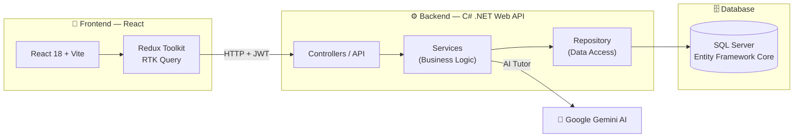
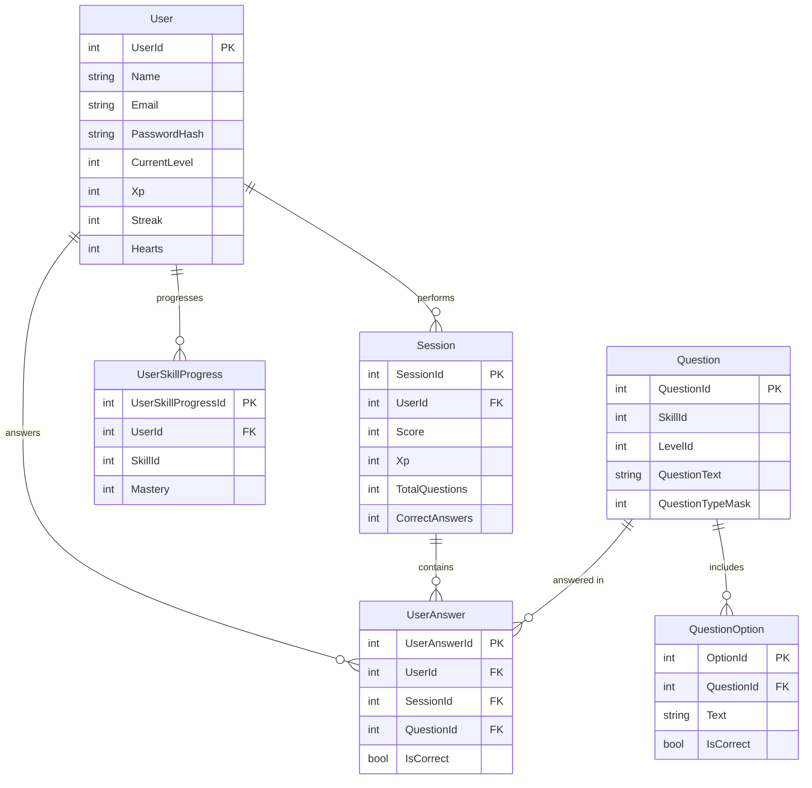

<div align="center">


# 🦉 Glottie — AI-Powered English Learning Platform

### Learn English the smart way: adaptive practice, gamification, and a personal AI tutor

**Backend (this repo) · ASP.NET Core Web API · Entity Framework Core · SQL Server · Google Gemini**

[](https://dotnet.microsoft.com)
[](https://www.microsoft.com/sql-server)
[](https://ai.google.dev)
[](https://github.com/tehila4510/glottie-frontend)

</div>

---

## 📌 Overview

**Glottie** is a full-stack English learning application built around three ideas:

- **Adaptive learning** — a placement test sets your starting level (A1–C2), and the question engine keeps adjusting difficulty to your performance in real time.
- **Gamification** — XP, hearts, daily streaks, and celebration animations keep practice motivating.
- **An AI conversation tutor** — free-form chat practice with instant corrections, powered by Google Gemini.

This repository contains the **backend**: a REST API with a layered architecture, JWT authentication, an adaptive question-selection algorithm, and background workers.

---

## 🔗 Project Repositories

<div align="center">

| Component | Description | Repository |
|:---:|:---|:---:|
| ⚙️ **Backend** (C# + SQL Server) | API server, business logic, and database | **[tehila4510/glottie-backend](https://github.com/tehila4510/glottie-backend)** *(this repo)* |
| 🎨 **Frontend** (React) | User interface and client application | **[tehila4510/glottie-frontend](https://github.com/tehila4510/glottie-frontend)** |

</div>

> 💡 The React frontend sends requests to this .NET backend, which communicates with SQL Server and the Google Gemini API.

---

## 📖 Table of Contents

- [Architecture Overview](#-architecture-overview)
- [Tech Stack](#-tech-stack)
- [Features](#-features)
- [Under the Hood](#-under-the-hood)
- [Database Design](#-database-design)
- [Project Structure](#-project-structure)
- [API Endpoints](#-api-endpoints)
- [The AI Tutor](#-the-ai-tutor-glottie-chat)
- [Running the Project](#-running-the-project)
---

## 🏗 Architecture Overview



**Typical request flow:** the user acts in the React app → RTK Query sends an HTTP request with a JWT → the Controller passes it to a Service (business logic) → the Repository reads or writes through Entity Framework → the response returns to the client.

---

## 🛠 Tech Stack

### ⚙️ Backend (this repo)
| Technology | Role |
|---|---|
| **C# / .NET Web API** | REST API server |
| **Entity Framework Core** | ORM, Code-First with Migrations |
| **SQL Server** | Relational database |
| **JWT Bearer Authentication** | Authentication and role-based authorization |
| **AutoMapper** | Mapping between entities and DTOs |
| **Google Gemini API** | Engine behind the conversation tutor |
| **BackgroundService** | Scheduled automatic reset of hearts |
| **IMemoryCache** | Caching of user answer history for the question algorithm |
| **Swagger / OpenAPI** | Interactive API documentation |

### 🎨 Frontend ([glottie-frontend](https://github.com/tehila4510/glottie-frontend))
React 18 · Vite · Redux Toolkit + RTK Query · React Router · Material UI · Web Speech API

---

## ✨ Features

### 🎓 Learning Experience
- **Placement Test** — determines the user's starting level (A1–C2).
- **Manual Level Selection** — with a visual description of each level.
- **9 Skill Areas** — vocabulary, grammar, verbs, listening, reading, writing, pronunciation, phrases, and chat.
- **Versatile Question Engine** — up to 18 question types (multiple choice, fill-in-the-blank, drag-and-drop, matching, ordering, listening, pronunciation, translation, and more), encoded compactly with a **bitmask**.
- **Real-Time Feedback** — instant correct/incorrect results with explanations.

### 🎮 Gamification
| | Feature | Description |
|:---:|---|---|
|  | **XP Points** | Earned at the end of every session, with bonuses for high scores and hard questions |
| ❤️ | **Hearts** | A limited number of mistakes, restored automatically by a background worker |
|  | **Daily Streak** | Tracks consecutive days of learning |
| 🎉 | **Celebration** | A rewarding animation at the end of each session |

### 📊 Progress Tracking
- **Progress Dashboard** — weekly XP chart, accuracy rings, and per-skill breakdown.
- **"My Mistakes"** — every incorrect answer next to the correct one, so users learn from their errors.
- **Heatmap** — a visual tracker of practice days.

### 👤 User Management
- Registration and login with **JWT**.
- Profile picture upload, plus editing of name, email, and password.
- Persistent sessions, so users stay logged in after a refresh.

---

## 🧠 Under the Hood

A few of the more interesting parts of the backend:

**Adaptive question selection.** Each next question is chosen based on the user's level, how many answers they got right in the current session, and their answer history. The target difficulty moves up or down as they perform, and candidate questions are weighted so that recently answered ones are less likely to repeat. Queries are filtered at the database level, and answer history is cached in memory.

**Session scoring.** The session score takes into account the question's level, the time taken to answer, and the number of attempts. XP is then awarded from the score, with bonuses for strong results and for solving hard questions on the first try. Very short sessions earn no XP.

**Streak and level logic.** Streaks are updated from the date of the last activity, and the user's level is derived from accumulated XP against per-level thresholds.

**Background worker.** A `BackgroundService` runs on a schedule (every two hours) and restores hearts for all users, using scoped services inside the hosted service.

**Security.** All endpoints require a JWT, the user identity is read from the token claims rather than from request bodies, and admin-only endpoints are protected with role-based authorization.

---

## 🗄 Database Design

The database runs on **SQL Server**, managed by **Entity Framework Core** with a **Code-First** approach (tables are generated from the C# classes through Migrations).



**Core tables:**
- **User** — user details, level, XP, hearts, and streak.
- **Session** — a single practice session with its score and number of correct answers.
- **Question** + **QuestionOption** — the question bank and its possible answers.
- **UserAnswer** — every answer a user submitted (powers the "My Mistakes" page).
- **UserSkillProgress** — the user's mastery in each skill.

> **Levels and skills** are static data in code (6 CEFR levels from A1 to C2, and 9 skills).

---

## 📂 Project Structure

The server uses a **layered architecture** for a clear separation of concerns:

```
glottie-backend/
├── MyProject/        → API layer (Controllers, Program.cs, configuration)
├── Services/         → Business logic (Services, AutoMapper, background Workers)
├── Repository/       → Data access (Entities, Repositories, Interfaces)
├── DataContext/      → EF Core DbContext + Migrations
├── Common/           → Shared code (DTOs, Enums, Exceptions, Static Data)
└── docs/assets/      → Logo and screenshots used in this README
```

Each layer depends only on the layer beneath it, which keeps the code organized and easy to maintain and test.

---

## 🌐 API Endpoints

| Controller | Example Endpoints | Role |
|---|---|---|
| **User** | `POST /api/User/register`, `POST /api/User/login`, `POST /api/User/lose-heart` | Registration, login, user management |
| **Quiz** | `POST /api/Quiz/start-session`, `GET /api/Quiz/next-question/{id}`, `POST /api/Quiz/submit-answer`, `POST /api/Quiz/end-session/{id}` | The practice flow |
| **Question** / **QuestionOption** | `GET/POST/PUT/DELETE` | Managing the question bank |
| **Session** | `GET /api/Session/my-sessions` | Session history |
| **UserAnswer** | `GET /api/UserAnswer/my-answers` | The user's answers |
| **UserSkillProgress** | `GET /api/UserSkillProgress/my-skill-progress` | Skill progress |
| **Skill** | `GET /api/Skill` | List of skills |
| **Chat** | `POST /api/Chat/ask` | Conversation with the AI tutor |

> All endpoints can be tested through **Swagger** while the server runs in Development mode.

---

## 🤖 The AI Tutor (Glottie Chat)

<div align="center">

</div>

One of the project's most advanced features is a **virtual English tutor** for free-form conversation, powered by **Google Gemini**.

- The conversation history travels with every new message, so the tutor always has context.
- A **system instruction** guides the AI to speak in simple English, point out and correct mistakes, and end each reply with a follow-up question that keeps the conversation going.
- Users practice English through natural conversation and get corrections in real time.

---

## 🚀 Running the Project

### Prerequisites
- **.NET SDK**
- **SQL Server** (or SQL Server Express / LocalDB)
- **Node.js 18+** (for the frontend)
- A **Google Gemini API key**

### 1️⃣ Run the Backend

```bash
git clone https://github.com/tehila4510/glottie-backend.git
cd glottie-backend
```

Create `MyProject/appsettings.json` (it is excluded from version control because it holds secrets):

```json
{
  "ConnectionStrings": {
    "DefaultConnection": "Server=(localdb)\\MSSQLLocalDB;Database=Glottie;Trusted_Connection=True;"
  },
  "Jwt": {
    "Key": "replace-with-a-long-random-secret-at-least-32-characters"
  },
  "GeminiSettings": {
    "ApiKey": "your-gemini-api-key"
  }
}
```

Then create the database and start the server:

```bash
dotnet ef database update --project DataContext --startup-project MyProject
dotnet run --project MyProject
# Swagger UI is available in Development mode
```

### 2️⃣ Run the Frontend

```bash
git clone https://github.com/tehila4510/glottie-frontend.git
cd glottie-frontend/my-react-app
npm install
npm run dev
# The app will open at http://localhost:5173
```

### 3️⃣ First Use
1. Open `http://localhost:5173`
2. Click **GET STARTED** and register
3. Choose a level manually **or** take the placement test
4. Start learning! 🎉

---

<div align="center">

### 🦉 A full-stack project built with care

**React · C# .NET · SQL Server · AI**

*Keep learning, keep growing.*

</div>
